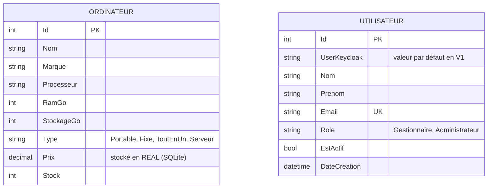

# RepairIT

**Binôme :** YEN Huanjie MYCHALSKI Ronan

Application de gestion d'un prestataire de **vente et de réparation d'ordinateurs**, développée en microservices avec ASP.NET Core, Blazor et EF Core (projet ALTN71 – EFREI 2026-2027).

Ce dépôt contient la **version 1 : Catalogue informatique**.

---

## Sommaire

1. [Architecture](#architecture)
2. [Lancer le projet](#lancer-le-projet)
3. [Microservices et endpoints](#microservices-et-endpoints)
4. [Modèle de données](#modèle-de-données)
5. [Choix techniques](#choix-techniques)
6. [Tests unitaires](#tests-unitaires)
7. [Intégration continue](#intégration-continue)
8. [Organisation Git](#organisation-git)
9. [Avancement et suite du projet](#avancement-et-suite-du-projet)

---

## Architecture

```
RepairIT.sln
├── RepairIT.Client                   Front Blazor WebAssembly (port 5000)
├── RepairIT.Gateway                  Gateway YARP : point d'entrée unique des API (port 5010)
├── RepairIT.CatalogService           API du catalogue d'ordinateurs (port 5101)
├── RepairIT.UsersService             API des utilisateurs (port 5102)
├── RepairIT.RepairService            API des réparations – squelette (port 5103)
├── RepairIT.SalesService             API des ventes – squelette (port 5104)
├── RepairIT.CustomersService         API des clients – squelette (port 5105)
├── RepairIT.AuthentificationService  API d'authentification (Keycloak) – squelette (port 5106)
├── RepairIT.Shared                   Modèles, énumérations et DTO partagés (classlib)
├── RepairIT.CatalogService.Tests     Tests unitaires du catalogue (xUnit, Moq)
└── RepairIT.UsersService.Tests       Tests unitaires des utilisateurs (xUnit, Moq)
```

Flux des appels :

```
Client Blazor (5000)
      │
      ▼
Gateway YARP (5010)
      ├── /api/ordinateurs/**  → CatalogService (5101) → catalog.db
      └── /api/utilisateurs/** → UsersService   (5102) → users.db
```

Le front n'appelle **que** la Gateway : aucune adresse directe de microservice n'est utilisée côté client.

Organisation interne d'un microservice :

```
RepairIT.CatalogService
├── Controllers/   Endpoints REST (reçoivent le service par injection)
├── Services/      Interface + implémentation de la logique métier
├── Data/          Contexte EF Core + initialisation de la base
├── Migrations/    Migrations EF Core (générées avec dotnet ef)
├── Program.cs     Injection des dépendances, base, Swagger
└── appsettings.json  Chaîne de connexion et niveaux de log
```

---

## Lancer le projet

### Prérequis

- SDK **.NET 10**
- Outil EF Core : `dotnet tool install --global dotnet-ef`

### Base de données

Aucune commande à lancer : les migrations EF Core sont versionnées dans les dossiers `Migrations`, et chaque API crée ou met à jour sa base SQLite au démarrage (`Database.Migrate()`).

Après une modification d'un modèle, créer une nouvelle migration dans le projet concerné :

```
dotnet ef migrations add NomDeLaMigration
```

### Lancer tous les projets en une fois

Double-cliquer sur **`lancer-repairit.bat`** (ou le lancer depuis un terminal à la racine).

Le script compile la solution, puis ouvre une fenêtre par projet. Le front est accessible sur **http://localhost:5000**.

| Projet | Adresse |
|---|---|
| Client Blazor | http://localhost:5000 |
| Gateway | http://localhost:5010 |
| CatalogService | http://localhost:5101/swagger |
| UsersService | http://localhost:5102/swagger |
| RepairService | http://localhost:5103/swagger |
| SalesService | http://localhost:5104/swagger |
| CustomersService | http://localhost:5105/swagger |
| AuthentificationService | http://localhost:5106/swagger |

Au premier lancement, chaque base est remplie avec un jeu de données de départ (6 ordinateurs ; utilisateurs user1, user2 et user3, les mêmes comptes que dans Keycloak).

---

## Microservices et endpoints

### CatalogService – `/api/ordinateurs`

| Verbe | Route | Réponses |
|---|---|---|
| GET | `/api/ordinateurs` | 200 : liste triée par marque puis nom |
| GET | `/api/ordinateurs/{id}` | 200, 404 si introuvable |
| POST | `/api/ordinateurs` | 201 + en-tête `Location`, 400 si données invalides |
| PUT | `/api/ordinateurs/{id}` | 204, 404 si introuvable |
| DELETE | `/api/ordinateurs/{id}` | 204, 404 si introuvable |

### UsersService – `/api/utilisateurs`

| Verbe | Route | Réponses |
|---|---|---|
| GET | `/api/utilisateurs` | 200 : liste triée par nom |
| GET | `/api/utilisateurs/{id}` | 200, 404 si introuvable |
| POST | `/api/utilisateurs` | 201, 400 si données invalides, 409 si l'e-mail est déjà utilisé |

### Services squelettes

`RepairService`, `SalesService`, `CustomersService` et `AuthentificationService` exposent pour l'instant `GET /api/statut`, qui confirme que le service répond.

---

## Modèle de données

Chaque microservice possède **sa propre base** (principe des microservices) : `catalog.db` pour le catalogue, `users.db` pour les utilisateurs.



- **Aucun mot de passe** n'est stocké : l'authentification sera déléguée à Keycloak.
- `UserKeycloak` vaut `non-lie-keycloak` tant que les comptes ne sont pas reliés à Keycloak.
- L'e-mail d'un utilisateur est **unique** (index unique en base, vérifié aussi par le service).

---

## Choix techniques

| Sujet | Choix | Raison |
|---|---|---|
| Modèles partagés | `RepairIT.Shared` (sans dépendance à EF Core) | Le front et les API utilisent les mêmes classes ; les règles de validation (`[Required]`, `[Range]`…) sont écrites une seule fois |
| Injection de dépendances | Interface + implémentation (`IOrdinateurService`), `AddScoped` | Le contrôleur ne dépend que du contrat, ce qui permet de le tester avec un mock |
| Configuration | Chaînes de connexion, URL de la Gateway et origine CORS dans `appsettings.json` | Rien n'est écrit en dur dans le code |
| Logging | `ILogger<T>` injecté dans les services et contrôleurs | Trace des créations, modifications, suppressions et des erreurs 404/409 |
| Base de données | EF Core + SQLite (V1), une base par microservice | Demandé pour la V1 ; le passage à PostgreSQL ne changera que `UseSqlite` et la chaîne de connexion |
| Prix | `decimal` en C#, converti en `double` en base | SQLite ne sait ni trier ni additionner des `decimal` |
| Accès aux données | LINQ asynchrone (`ToListAsync`, `FirstOrDefaultAsync`…) | Le serveur n'est pas bloqué pendant les requêtes |
| Gateway | YARP, routes dans `appsettings.json` | Point d'entrée unique pour le front, CORS géré à un seul endroit |
| Front | Blazor WebAssembly + clients HTTP typés (`AddHttpClient<IService, Service>`) | HttpClientFactory, recommandé par le cours ; design personnalisé (pas le thème Blazor par défaut) |
| Énumérations | Sérialisées en texte (`JsonStringEnumConverter`) | JSON lisible (`"Portable"` plutôt que `0`) dans Swagger et le front |

---

## Tests unitaires

Outils : **xUnit**, **Moq**, **EF Core InMemory**.

- Les **services** sont testés sur une base en mémoire, recréée vide pour chaque test.
- Les **contrôleurs** sont testés avec un service simulé (Moq), pour vérifier les codes HTTP renvoyés.

```
dotnet test
```

Couverture de code (objectif : 50 % minimum) :

```
dotnet test --collect:"XPlat Code Coverage"
```

Les rapports `coverage.cobertura.xml` sont générés dans le dossier `TestResults` de chaque projet de tests.

---

## Intégration continue

Le workflow GitHub Actions `.github/workflows/ci.yml` s'exécute à chaque commit (toutes les branches) et sur les Pull Requests vers `main` et `production`. Il est dédié uniquement à l'intégration continue :

1. restauration des dépendances (`dotnet restore`) ;
2. compilation (`dotnet build`) ;
3. exécution des tests (`dotnet test`) ;
4. calcul et publication de la couverture de code (ReportGenerator).

Le pourcentage de couverture est affiché dans le résumé de chaque exécution (onglet **Actions**) et le rapport détaillé est téléchargeable en bas de la page. Les migrations EF Core, les `Program.cs` et le code OpenAPI généré automatiquement sont exclus du calcul (`coverlet.runsettings`).

---

## Organisation Git

| Branche | Rôle |
|---|---|
| `production` | Dernière version livrée et corrigée |
| `main` | Branche d'intégration du binôme |
| `feature/...` | Une branche par fonctionnalité, fusionnée dans `main` |

Livraison d'une version : **Merge Request de `main` vers `production`**, qui centralise les remarques de l'enseignant.

---

## Avancement et suite du projet

### Version 1 – Catalogue informatique

- [x] Création de la solution et de tous les projets (front, Gateway, API, Shared, tests)
- [x] CRUD des ordinateurs (API + page Blazor)
- [x] Création et liste des utilisateurs (UserKeycloak par défaut)
- [x] EF Core + SQLite, initialisation des bases au démarrage
- [x] Injection des dépendances, logging, configuration
- [x] Tests unitaires (services et contrôleurs)
- [x] Intégration continue GitHub Actions avec couverture de code
- [x] Script `lancer-repairit.bat`
- [x] README
